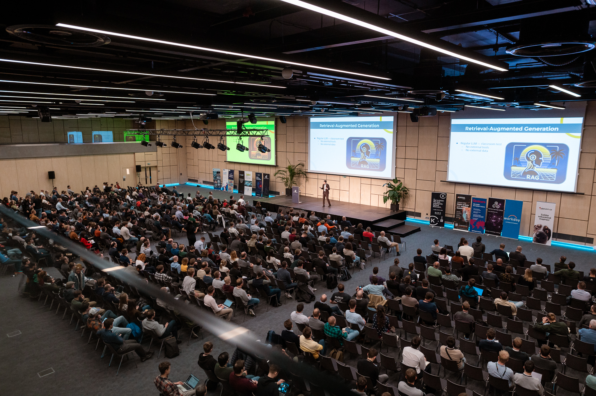
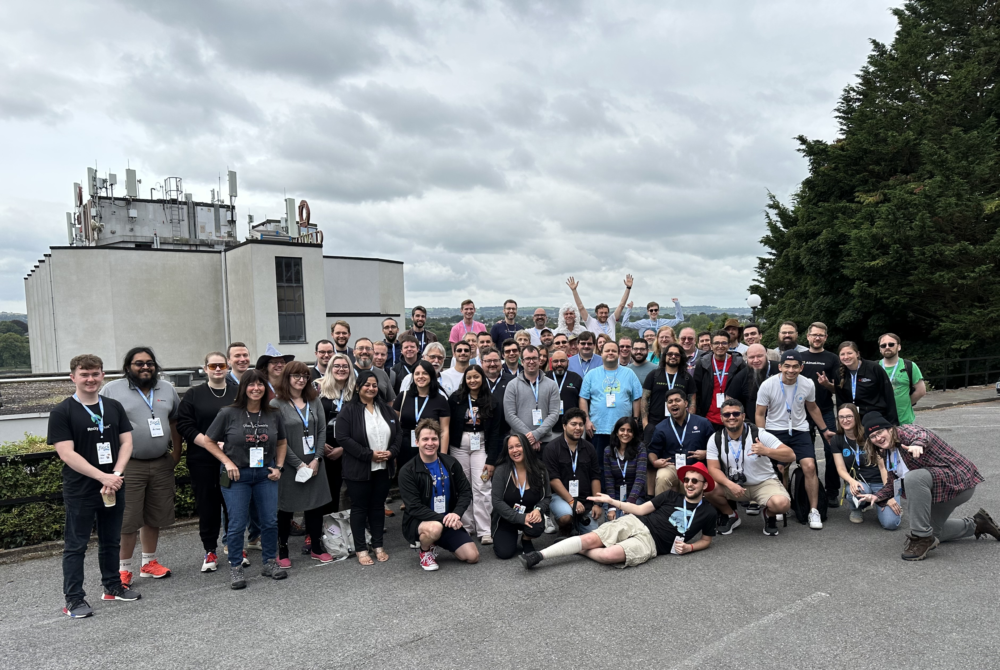
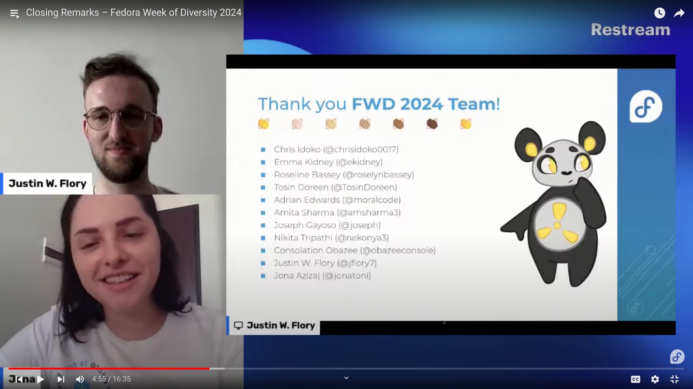
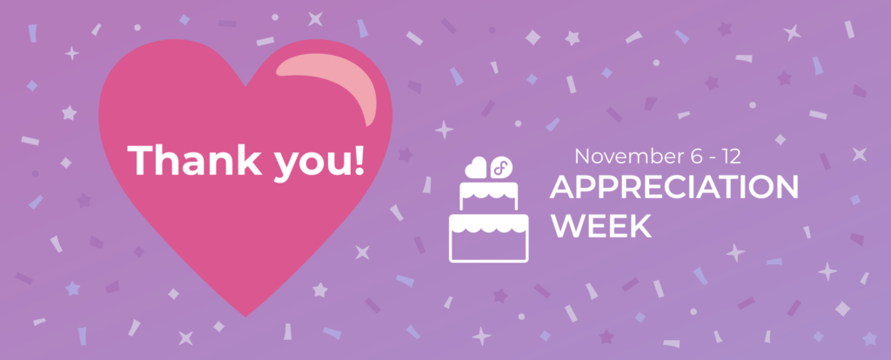
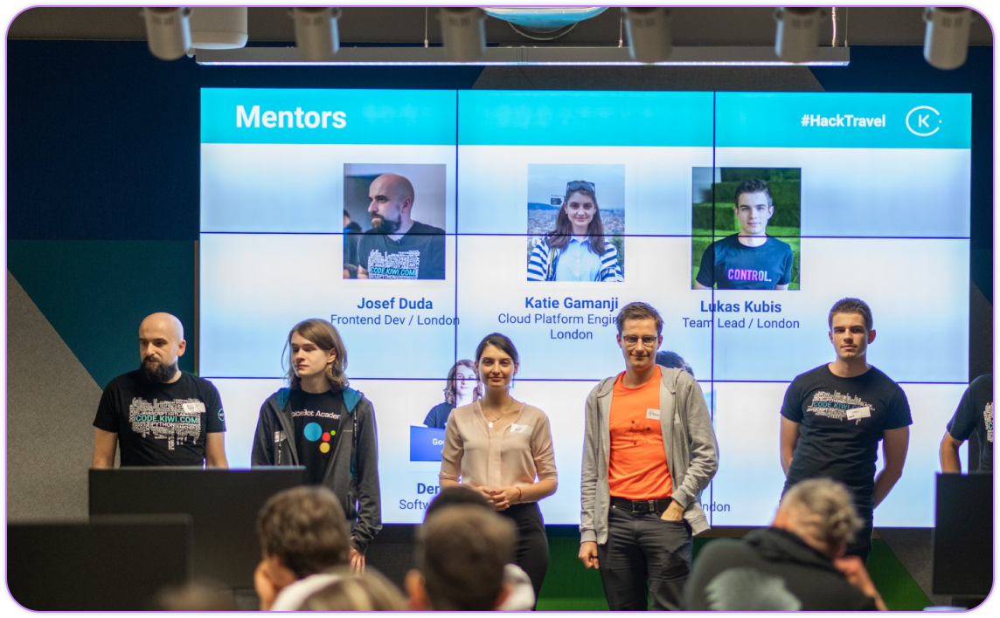
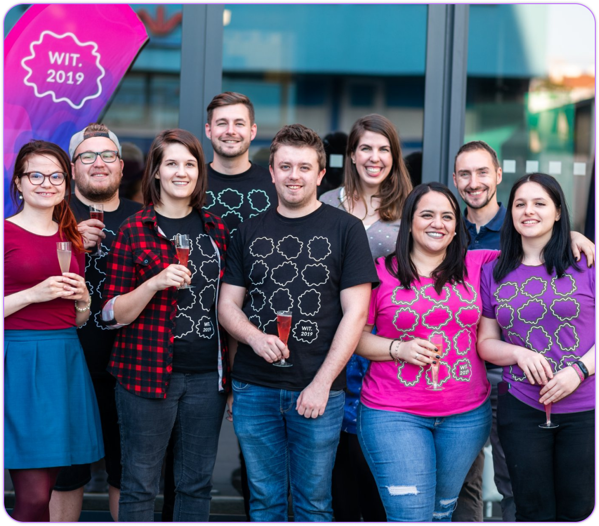
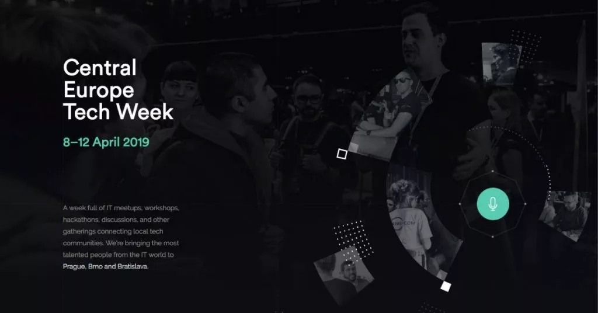
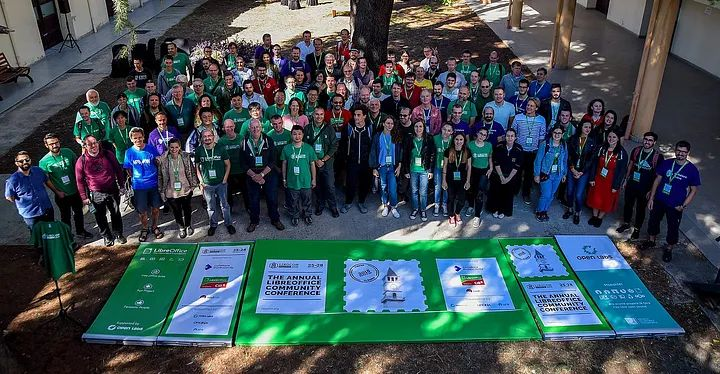
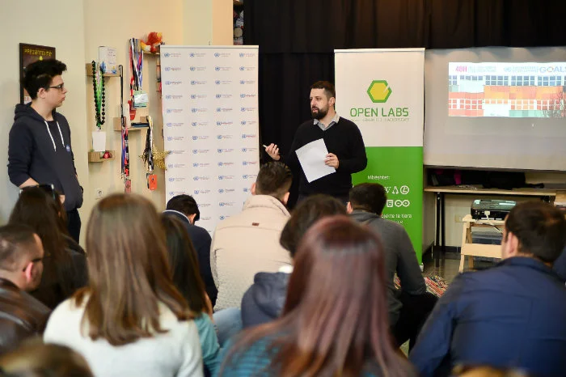
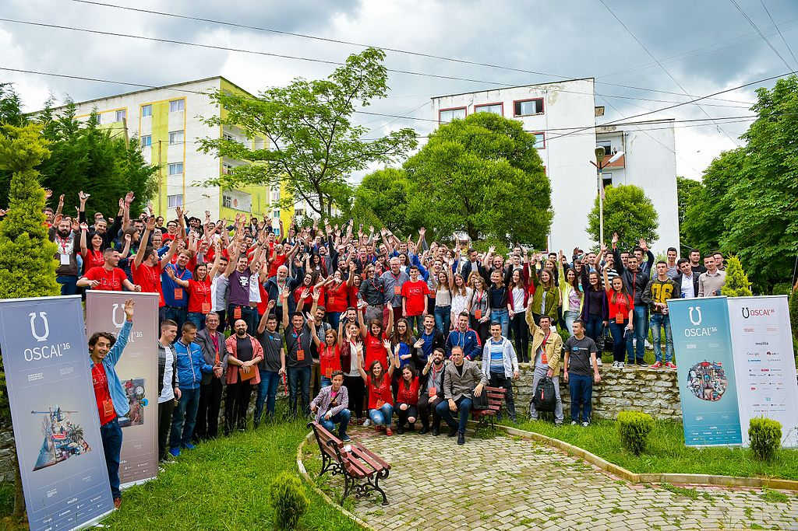

# Events at a glance

| Event | Years | Location | Format | Size | My role |
|---|---|---|---|---|---|
| Fedora Mentor Summit and Flock to Fedora | 2022–present | Online; Cork, Ireland; Rochester, USA; Prague, Czech Republic (x2) | Online, then hybrid | 100–200 | Mentor Summit: lead organizer (CFP, agenda, production). Flock: CFP review, on-site support, room moderation |
| Machine Learning Prague | 2020–present | Prague, Czech Republic | Hybrid | 500–800+ | 2020 full production; partnerships since |
| Fedora Week of Diversity | 2021–2024 | Online | Online | 50–100 | Lead organizer and project manager |
| Fedora Appreciation Week | 2018 & 2023 | Online | Online | 50+ | Led organization |
| Global Travel Hackathon | 2019 | Barcelona, Spain; London, UK; Belgrade, Serbia | In person, 3 cities | 200+ | Main organizer |
| Central Europe Tech Week | 2019 | Prague & Brno, Czech Republic; Bratislava, Slovakia | In person | ~150 | Led speaker coordination |
| Women in Tech Conference | 2019 | Brno, Czech Republic | In person | 150+ | Organizing team: speakers, panel host |
| LibreOffice Conference | 2018 | Tirana, Albania | In person | ~150 | Led local team: venue, partners, budget |
| OSCAL | 2014–2018 | Tirana, Albania | In person | ~150 | Organizing team: speakers, partners, volunteers, venue |
| 48H Open Source Hackathon | 2017 | Tirana, Albania | In person | ~80 | Project coordinator: attendees, venue |

# Machine Learning Prague (2020 - present)

## About MLPrague 🇨🇿

The biggest European conference about ML, AI and Deep Learning applications
running in person in Prague and online.

**Who attends:**

- ML, AI and deep learning practitioners
- Community & leadership: technical managers, community managers,
executive leaders
- Academic/Media/Other: professors, students, media, analysts,
product managers

## Responsibilities

- In 2020, when the event transitioned to an online format, I managed the entire event production, community, and partnerships collaborations.
- Currently, I lead event partnerships, finding new partners and coordinating closely with stakeholders to ensure their presence at the event.

## Links

**Website**: https://www.mlprague.com/

**Previous years**:

2021: https://2021.mlprague.com/

2022: https://www.mlprague.com/prague2022/ 

2023: https://www.mlprague.com/prague2023/

2024: https://www.mlprague.com/prague2024/

2025: https://www.mlprague.com/prague2025/

2026: https://www.mlprague.com/prague2026/

# Fedora Mentor Summit and Flock (2022 - present)

## What is Fedora Mentor Summit and Flock?

Mentor Summit focuses on workshops and sessions to promote mentorship best practices and to connect mentors and mentees across the Fedora community.

Flock to Fedora is the Fedora Project's annual contributor conference. It moves to a different city each year, and the Fedora Mentor Summit takes place alongside it.

## Responsibilities

**Fedora Mentor Summit (lead organizer)**

- Lead event organizer and event ideator for the Fedora Mentor Summit.
- In 2022, we organized the event online, and since 2023, the event has been hybrid.
- Manage the event's Call for Proposals (CFP), review applications, and build the agenda.
- Handle event production, project management, and support team members when needed.

**Flock (team member)**

- **2027 (upcoming):** Leading promotion and marketing for the conference.
- **Previous editions:** Part of the CFP review team.
- Provided on-the-ground support in Prague.
- Moderated sessions in the in-person rooms.

## Links

[Planning repository](https://forge.fedoraproject.org/dei/fedora-mentor-summit/issues?q=&type=all&sort=relevance&state=all&labels=&milestone=0&project=0&assignee=0&poster=0&archived=false)

**Previous years**:

2022: https://www.youtube.com/playlist?list=PL0x39xti0_65QiQfG3g3uSvWYkRsKkxzq (Virtual)

2023: https://youtube.com/playlist?list=PL0x39xti0_64OcXEGLCtoI4nouADqaTcT&si=tAmLyR9Jm-vWGgkx (Cork, Ireland 🇮🇪)

2024: https://youtu.be/LAEe-27OI5w (Rochester, New York, United States of America 🇺🇸)

2025: https://youtube.com/playlist?list=PL0x39xti0_67BysOQF2C5BlFPUNo9vM-A&si=SPNcGP2bcaR010nE (Prague, CZ 🇨🇿)

2026: https://youtu.be/ugj8OkeLoSw (Prague, CZ 🇨🇿)

# Fedora Week of Diversity (2021 - 2024)

## What is Fedora Week of Diversity (FWD)?

Every year, FWD serves as a platform to spotlight the different members and their noteworthy contributions to the community and projects they work on. 

2024 theme, “Empowering Diversity, Enriching Communities,” acknowledges the views, perspectives, and talents of individuals from different backgrounds, experiences, and walks of life, impacting not only our community but also extending across the entire open-source ecosystem.

💡 FWD is a time when we come together to honor the diverse voices, perspectives, and skills that enrich the vibrant Fedora community.

## Responsibilities

- Lead event organizer and project manager.
- Coordinate event planning, team meetings, deadlines/milestones, and provide support to community members when they need help.
- Manage the event's online platform, which includes coordinating with stakeholders to set up necessary tools such as Matrix, Jitsi, Pretalx, and Pretix, as well as creating guidelines for attendees.
- Conduct follow-ups with attendees, speakers, and the team post-event.

## Links

[Planning repository](https://gitlab.com/fedora/dei/week-of-diversity)

**Event recap**:

https://discussion.fedoraproject.org/t/recap-of-fedora-week-of-diversity-2024/124450

https://communityblog.fedoraproject.org/fedora-week-of-diversity-2024-recap/

https://youtube.com/playlist?list=PL0x39xti0_67oLN5oUN8lYj0a29xWCQLZ&si=HwDJBGjuiI8cSf0v

# Fedora Appreciation Week (2018 & 2023)

## What is Fedora Appreciation Week

Fedora Appreciation Week, abbreviated as FAW, is a week-long event organized by the Fedora DEI Team dedicated to celebrating the efforts of Fedora Project contributors and expressing gratitude to one another. 

Throughout Fedora Appreciation Week, we encourage all community members to select either an individual contributor or a group of contributors to thank for their work in Fedora. This includes all types of contributions, from development, design, infrastructure, marketing, engineering, and more. Let’s come together to celebrate the collective efforts that make Fedora what it is today.

## Responsibilities

- In 2023, I led the event organization for Fedora Appreciation Week.
- I managed all event communications, promotion schedules, coordination with stakeholders, post-event follow-ups, and metrics.

## Links

**Article**: [https://communityblog.fedoraproject.org/fedora-appreciation-week-2023/](https://communityblog.fedoraproject.org/fedora-appreciation-week-2023/) 

**Issue**: https://gitlab.com/fedora/dei/home/-/issues/15

**Event planning**: https://hackmd.io/@fedora-dei/By9xremgT

# Global Travel Hackathon 2019

## Responsibilities

- Main organizer of the Global Travel Hackathon, which was held in three locations: Barcelona, London, and Belgrade.
- Responsible for event ideation, including establishing rules, project submission guidelines, evaluation criteria, and forming juries.
- My role in this event includes planning across all three locations, managing event production and logistics, coordinating attendees and evaluations, securing speakers and mentors, conducting post-event follow-ups, and coordinating with stakeholders to determine and announce the winner of the hackathon.

## Links

[Planning repository](https://github.com/Global-Travel-Hackathon) 

**Article**: https://code.kiwi.com/articles/get-to-know-penguin-bots-the-winners-of-global-travel-hackathon/

[Event video](https://www.youtube.com/watch?v=RhTWOqkMzFI)

# Women in Tech Conference 2019

## Responsibilities

- The Women in Tech conference was held in Brno, Czech Republic, and I was part of the organizing team.
- My role included finding speakers for the event and coordinating logistics with them.
- I also hosted a panel discussion during the event, with the topic "My Way to Tech."

## Links

**Articles:**

https://code.kiwi.com/articles/kiwi-coms-women-in-tech-inspires-women-to-pursue-career-in-tech/

https://code.kiwi.com/articles/join-the-forum-on-women-in-tech-2019/

[Event video](https://youtube.com/playlist?list=PLZ2MSsGS8WE2v8MR9npAqh79lGPHMYFRp&si=XDfzlzqKKBojHBJO)

# Central Europe Tech Week 2019

## Responsibilities:

- A week full of Tech events, where we brought the most talented people from the IT world to Prague, Brno, and Bratislava.
- I led the speaker coordination area, where I was responsible for finding speakers for our events, reaching out to them, coordinating travel logistics, and managing agenda details.

## Links

Article: https://code.kiwi.com/articles/join-the-central-europe-tech-week/

[Event video](https://youtube.com/playlist?list=PLZ2MSsGS8WE3e-P4MpCXqiX5cs1NXVtih&si=pkImgfmUM_BdOPFL)

# LibreOffice Conference 2018

- The LibreOffice conference rotates countries each year. In 2018, it was in Tirana, Albania, organized by Open Labs, where I led the local team.
- In this role, I focused on project management, coordinating with partners, managing venue logistics, and tracking the budget.

**Website**: [https://conference.libreoffice.org/2018/](https://conference.libreoffice.org/2018/) and video [https://youtu.be/TMtyFDcZEUg](https://youtu.be/TMtyFDcZEUg)

# 48H Free Open Source Hackathon 2017

- In 2017, we organized the first-ever 48-hour "open source" hackathon focused on the United Nations Sustainable Development Goals.
- As the project coordinator for the event, I managed communication with attendees and handled venue logistics, while also ensuring that other team members delivered their respective tasks on time.

**Article**: [https://opensource.com/article/17/3/open-labs-48-hour-hackathon-albania](https://opensource.com/article/17/3/open-labs-48-hour-hackathon-albania)

# Open Source Conference Albania - OSCAL (2014 - 2018)

- As a board member of the Open Labs Hackerspace, I've been part of the organizing team for OSCAL for five years.
- Throughout different editions of OSCAL, my responsibilities have included coordinating speakers, managing partners, coordinating volunteers, venue coordination, and project management.

**Website**: [https://oscal.openlabs.cc/](https://oscal.openlabs.cc/)

